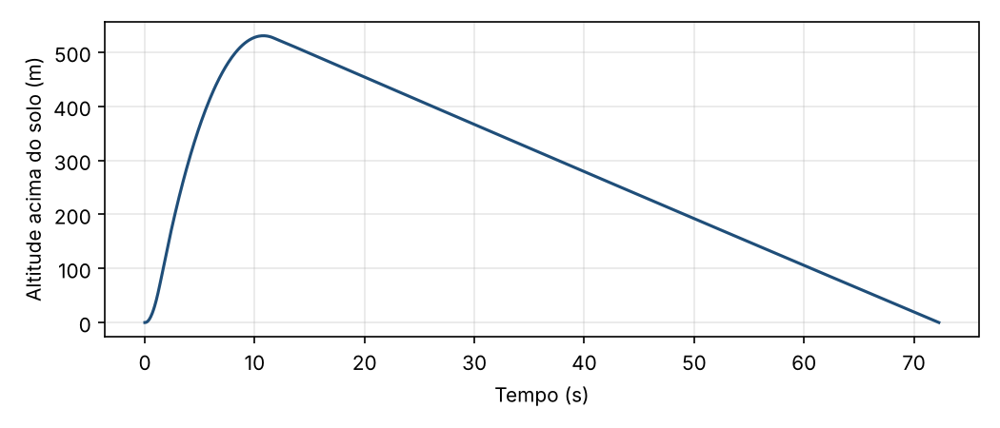

# Gerador Automático de Relatórios de Simulação de Foguetes

Ferramenta em Python que recebe os dados de um foguete em um arquivo simples (`foguete.json`), roda a simulação de voo com o [RocketPy](https://github.com/RocketPy-Team/RocketPy) e gera sozinha um **relatório em PDF** com os resultados, gráficos e alertas de segurança.

## O problema

Na EPTA, equipe de foguetemodelismo da UFU, cada mudança no projeto (massa, aletas, motor) exigia rodar a simulação de novo, copiar os resultados, montar gráficos e conferir a estabilidade manualmente antes de compartilhar com as outras áreas. Era um trabalho repetitivo, demorado e sujeito a erro.

## A solução

Basta editar o `foguete.json` e rodar um comando. Em menos de um minuto o programa:

- Simula o voo completo (subida, apogeu e descida com paraquedas)
- Calcula apogeu, velocidade máxima, velocidade de saída do trilho e margens de estabilidade
- **Emite alertas automáticos** se o foguete estiver instável, superestável ou saindo do trilho com velocidade baixa
- Gera os gráficos de altitude, velocidade e estabilidade
- Monta tudo em um PDF pronto para compartilhar com a equipe

## Exemplo de resultado



Veja o relatório completo em [`exemplo/relatorio_exemplo.pdf`](exemplo/relatorio_exemplo.pdf).

| Resultado | Valor |
|---|---|
| Apogeu | 530,7 m |
| Velocidade máxima | 101,6 m/s (Mach 0,30) |
| Velocidade de saída do trilho | 28,6 m/s |
| Margem estática inicial | 2,27 calibres |

*Os dados do exemplo são ilustrativos.*

## Como usar

```bash
pip install -r requirements.txt
python gerar_relatorio.py foguete.json
```

Para simular outro foguete, copie o `foguete.json`, troque os valores e rode o comando com o novo arquivo.

## Tecnologias

Python • RocketPy • Matplotlib • FPDF2

## Autor

**Guilherme Cintra Sousa** – Estudante de Engenharia Mecânica (UFU), gerente de Estruturas e Aerodinâmica na EPTA
[LinkedIn](https://www.linkedin.com/in/guilherme-cintra-sousa)
